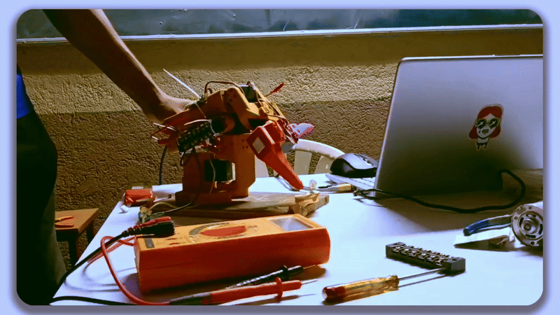

# 🤖 Robotic Servo Control / Robotic Hand

<p align="center">
  <strong>STM32-based servo-control experiments and robotic mechanism prototypes developed using embedded C, UART communication, and controller-driven interfaces.</strong>
</p>

<p align="center">
  
  
  
  
</p>

---

## 🎥 Hardware Demo

<p align="center">
  
</p>

<p align="center">
  <sub>Physical demonstration of the servo-driven robotic mechanism and controller interaction.</sub>
</p>

---

## 🧭 Overview

This repository contains a progression of STM32-based servo and motor-control projects developed while experimenting with embedded robotics and mechanism control.

The project set moves from basic UART-based servo control toward:

- multi-servo coordination,
- PS4 controller interfaces,
- picking mechanisms,
- servo operating modes,
- stepper integration,
- locomotion-oriented control,
- and physical robotic mechanism testing.

---

## 🧩 Project Collection

| # | Project | Focus |
|---:|---|---|
| 01 | `SERVO_UART` | Single-servo control through UART |
| 02 | `MULTI_SERVO_UART` | Multi-servo UART control |
| 03 | `PS4_SERVO_CONTROLLED` | PS4 → ESP receiver → STM32 → servo |
| 04 | `PS4_PICKING_MECHANISM_CONTROLLED` | PS4-controlled picking mechanism |
| 05 | `SERVO_WORK_MODE` | Servo operating-mode experiments |
| 06 | `SERVO_STEPPER_INTEGRATION` | Servo + stepper motor integration |
| 07 | `PS4_SERVO_STEPPER_CTRL` | Controller-driven servo and stepper system |
| 08 | `PS4_SERVO_STEPPER_LOCO_CONTROLLED` | Locomotion-oriented controller integration |
| 09 | `R1_PICKING_MECHANISM` | R1 robotic picking-mechanism control |
| 10 | `SERVO_ANGLE_CONTROL` | Servo positioning, angle control, and calibration |
| 11 | `STM_F4` | STM32F4-based control experiments |

---

## ⚙️ Technical Areas

### Embedded Control

- STM32F103
- STM32F4
- STM32 HAL
- STM32CubeIDE
- Embedded C
- UART communication
- timer / peripheral configuration

### Motion Control

- servo positioning
- multi-servo coordination
- stepper motor control
- servo + stepper integration
- robotic actuation

### Human-Machine Interface

- PS4 controller input
- ESP-based receiver interfaces
- UART communication between controllers and STM32

---

## 🔌 Typical Control Architecture

```text
      PS4 Controller
            │
            ▼
      ESP Receiver
            │
           UART
            │
            ▼
        STM32 MCU
            │
      ┌─────┴─────┐
      ▼           ▼
   Servos      Steppers
      │           │
      └─────┬─────┘
            ▼
      Robotic Mechanism
```

---

## 📌 Purpose

The repository is useful as a record of the incremental control work behind the final mechanism: individual actuator experiments, controller integration, coordination, and hardware testing.

---

<div align="center">

**From individual servo commands to a complete physical mechanism.**

</div>
